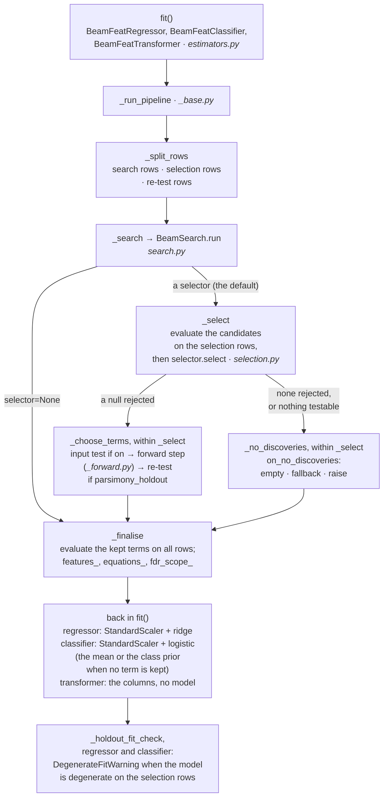
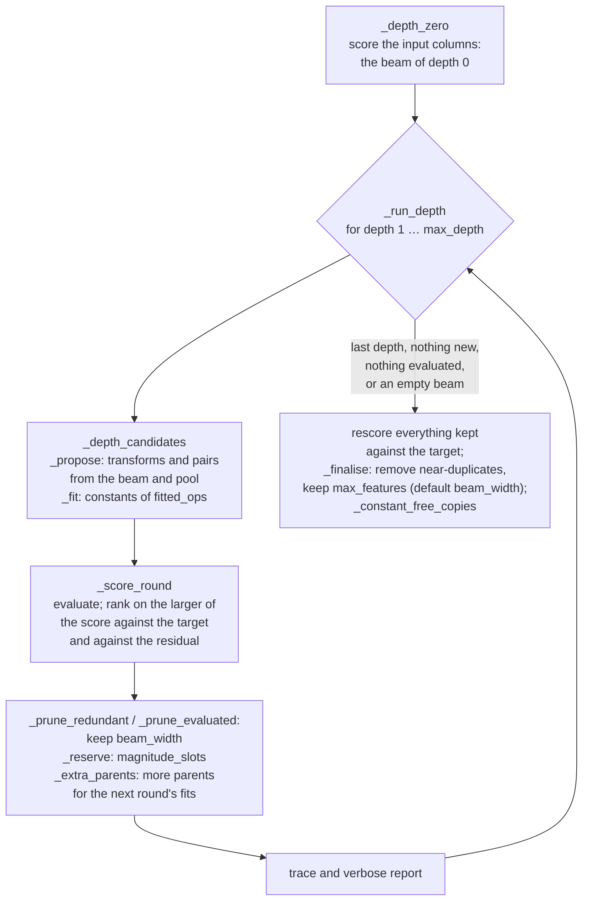
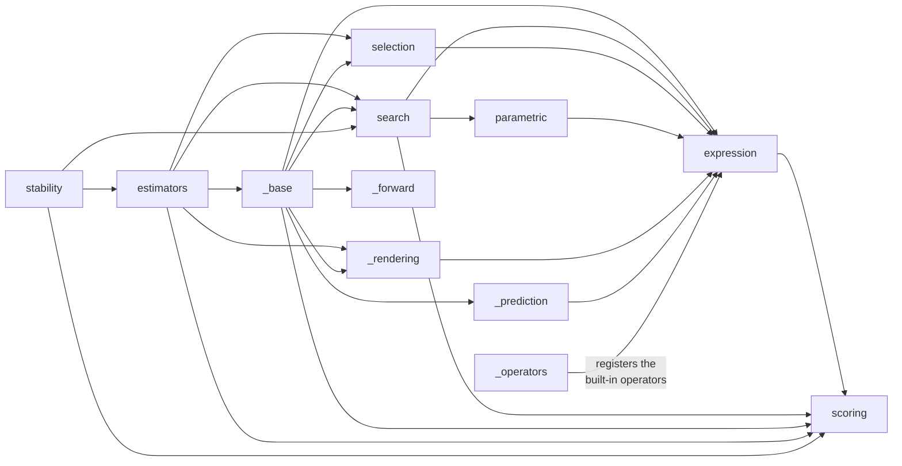

# Architecture

beamfeat builds candidate formulas from the columns of a table with a beam
search, tests each against the null that it is unrelated to the target on rows
the search never saw, and fits a linear model on the terms it keeps. This page
maps the code onto that: the stages of a fit, the stages of the search, and
the modules. The user documentation is at
[ld-shell.github.io/beamfeat](https://ld-shell.github.io/beamfeat/); the
guarantee and its scope are on its guarantees page.

## A fit, stage by stage

- **Rows.** With a selector (the default) and `selection_holdout` (0.5 by
  default), the search sees one part of the rows and the screen the other,
  provided both parts have at least 10 rows; otherwise the screen runs on the
  search rows and `fdr_controlled_` is `False`. That split is what the FDR
  guarantee rests on: the screen tests a candidate set fixed before it looked
  at its rows. `parsimony_holdout` splits the selection rows again for the
  re-test; without the first split it is ignored.
- **Screen.** The default, `selector="permutation"`, is a
  `PermutationSelector` with the estimator's `selection_correction`,
  Benjamini-Yekutieli by default. A selector instance passed in keeps its own
  settings (a `PermutationSelector()` uses Benjamini-Hochberg), with a warning
  where they differ from the estimator's. `selection_report_` records each
  candidate's statistic, its p- and q-value when the selector computes them,
  and whether its null was rejected. The guarantee covers the screened set.
- **Choice of terms.** The screened set, less, with `input_test=True`, any
  term with a column whose null the input test fails to reject (if that would
  leave none, the screened set is kept, with a warning); then, at the default
  `parsimony="forward"`, the forward step, which adds terms while each adds at
  least `parsimony_tol` to R² (and, with `parsimony_alpha`, rejects the null
  that chance reaches its gain); then, with `parsimony_holdout`, the terms the
  re-test certifies on rows of their own. When the re-test certifies none,
  or the selection rows are too few to split for it (with a warning), the
  terms before the forward step are returned instead: the screened set, less
  any the input test removed.
- **Prediction.** `predict` and `transform` replay the kept expressions on new
  rows without searching again (`_BeamFeatBase._apply`). An expression that
  fails on some rows, the logarithm of a negative value say, is evaluated row
  so that each row gets the value it would get alone (`_prediction.py`), and
  is NaN on the rows it fails on only. `_model_output` returns the model's
  output with NaN on those rows where the output is a float (predictions,
  probabilities), and the mask of rows that are defined; the classifier's
  `predict` gives an undefined row the most frequent training class, as its
  labels cannot be NaN.

## Inside the search

`_SearchState` carries the beam, the pool, everything kept so far and the
trace from one depth to the next. The constants of `fitted_ops` are fitted in
`parametric.py`. `_constant_free_copies` then swaps a kept feature that has
fitted constants for a near copy with fewer, among the expressions the search
accumulated but left out of the final set, when a likelihood-ratio test fails to reject the null that
the copy fits as well; of those, the simplest. The expressions are `Node`
objects from `expression.py`, evaluated and cached by its `Evaluator`.

## Modules

Arrows point from a module to one it imports. Not drawn: `__init__`, which
re-exports the public names of `estimators`, `expression`, `scoring`,
`search`, `selection` and `stability`, and `_compat`, the shim for
scikit-learn versions that `estimators`, `scoring`, `selection` and
`stability` use. `expression` imports `_operators` once, at its end, so that
the operators register in `OPERATORS` after everything they are built from
exists.

| module | what it holds |
| :-- | :-- |
| `estimators.py` | the three public estimators: their parameters, `fit`, `predict`, `transform`, and `equation` and `latex` for the regressor and the classifier |
| `_base.py` | `_BeamFeatBase`, what the three share: validation, units, the row split and the stages above, prediction on new rows (`_apply`, `_model_output`), the introspection methods (`formulas`, `to_sympy`, `latex_formulas`, `get_feature_names_out`), and the public warnings and errors |
| `_forward.py` | the forward step's path through the screened set and its chance check (`parsimony_alpha`) |
| `_rendering.py` | number and LaTeX formatting, the equation list (`equations`, for all three estimators) and the notes on what the guarantee covers |
| `_prediction.py` | the row-by-row evaluation of an expression that fails on some rows |
| `search.py` | `BeamSearch`, `SearchResult`, `SearchTrace`; the default operator sets (`DEFAULT_UNARY`, `DEFAULT_BINARY`, and `DEFAULT_FITTED`, the estimators' default; `BeamSearch` itself fits no constants unless given `fitted_ops`), `magnitude_scores`, and `report`, the verbose output |
| `parametric.py` | the constants inside `exp(a*x)`, `x^a`, `1/(x + a)` and `log(x + a)` |
| `expression.py` | `Node`, the expression DAG; `Evaluator`; units; the operator registry |
| `_operators.py` | the built-in operators: function, formula, unit rule, domain, constant grid |
| `scoring.py` | the scorers that rank candidates in the search |
| `selection.py` | the FDR-controlled selectors, the input test, and the Freedman-Lane test of the conditional re-test (`_ConditionalPermutationSelector`) |
| `stability.py` | `stability_report`: refits on many splits and counts the distinct equations |
| `_compat.py` | differences between scikit-learn versions |

## Where to make a change

| change | where |
| :-- | :-- |
| a new operator | a `register_operator(OperatorSpec(...))` call in `_operators.py`, and its sympy form in `_sympy_builders` in `expression.py` (without one, `to_sympy` and the LaTeX show it as an opaque function); a fitted operator whose constant can make it a plain operator or a constant also goes in `_PLAIN_FORMS` or `_DEGENERATE` there. To use it by default, add it to `DEFAULT_UNARY`, `DEFAULT_BINARY` or `DEFAULT_FITTED` in `search.py`. Tests in `tests/test_expression.py`; a fitted operator also in `tests/test_parametric.py`, whose `FITTED` names every one and which pins `DEFAULT_FITTED` |
| a new scorer | a `Scorer` subclass in `scoring.py`, named in `_SCORERS`; `tests/test_scoring.py` |
| a new selector | a `Selector` subclass in `selection.py`, named in `_SELECTORS`; `tests/test_selection.py` |
| how terms are chosen after the screen | `_BeamFeatBase._choose_terms` in `_base.py`, the forward step in `_forward.py`; `tests/test_parsimony.py` |
| prediction on new rows | `_apply` and `_model_output` in `_base.py`, `_prediction.py`, and each estimator's `predict` in `estimators.py`; `tests/test_estimators.py` |
| the printed equation or LaTeX | `_rendering.py`, and `equation` / `latex` in `estimators.py`; `tests/test_rendering.py` |
| the search | `search.py`: `_depth_candidates`, `_score_round`, `_prune_redundant`; `tests/test_search.py` |
| a new estimator parameter | `_BeamFeatBase.__init__` and each public class's `__init__` (scikit-learn reads a class's parameters from its own signature), `_validate_params`, and the `Args` of `BeamFeatTransformer`'s docstring, which the other two refer to |
| the documentation | `docs/`, with the pages listed in `mkdocs.yml`; the tutorials are generated by `notebooks/build_notebooks.py` (see `CONTRIBUTING.md`) |

The test files follow the code by topic: `tests/test_estimators.py` for the
estimators' API and prediction, `tests/test_screening.py` for the screen
inside a fit, `tests/test_parsimony.py` for the forward step, the re-test and
what the guarantee covers, `tests/test_rendering.py` for the renderings, and
one file each for `expression`, `parametric`, `scoring`, `search`,
`selection`, `stability` and `_compat`. ruff (`pyproject.toml`) limits the
complexity and the number of statements of a function everywhere but the
tests and the benchmark scripts, so a stage that grows is split rather than
lengthened.
