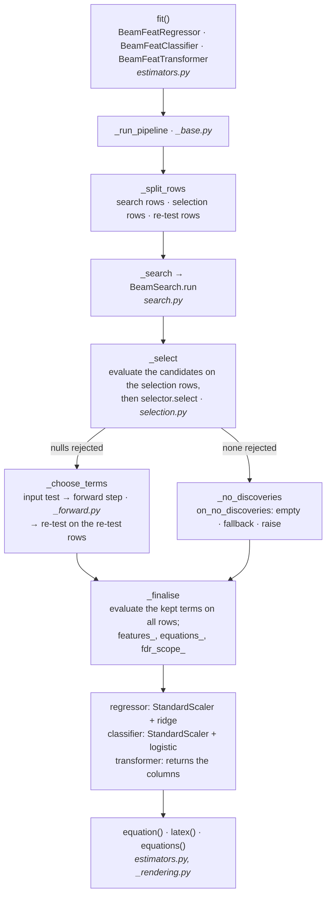
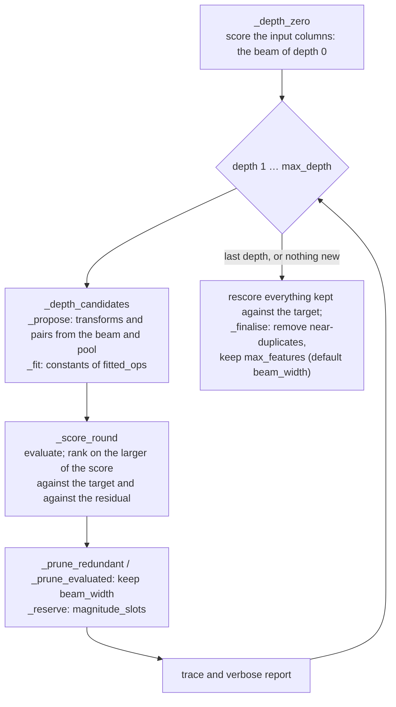
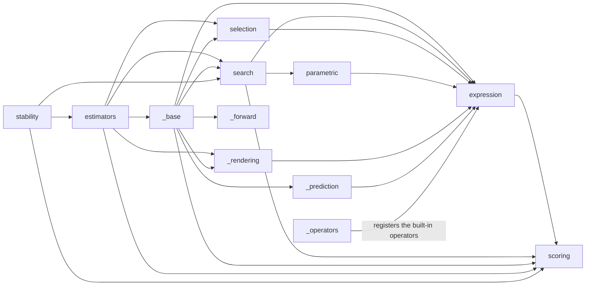

# Architecture

beamfeat builds candidate formulas from the columns of a table with a beam
search, tests each against the null that it is unrelated to the target on rows
the search never saw, and fits a linear model on the terms it keeps. This page
maps the code onto that: the stages of a fit, the stages of the search, and
the modules. The user documentation is at
[ld-shell.github.io/beamfeat](https://ld-shell.github.io/beamfeat/); the
guarantee and its scope are on its guarantees page.

## A fit, stage by stage

- **Rows.** With a selector (the default) and `selection_holdout` (0.5 by
  default), the search sees one part of the rows and the screen the other.
  That split is what the FDR guarantee rests on: the screen tests a candidate
  set fixed before it looked at its rows. `parsimony_holdout` splits the
  selection rows again for the re-test.
- **Screen.** `PermutationSelector` (the default, Benjamini-Yekutieli) or
  `KnockoffSelector` tests every candidate; `selection_report_` records each
  one's statistic, its p- and q-value when the selector computes them, and
  whether its null was rejected. The guarantee covers the screened set.
- **Choice of terms.** The screened set, less any term with a column whose
  null the `input_test` fails to reject; then, at the default
  `parsimony="forward"`, the forward step, which adds terms while each adds
  at least `parsimony_tol` to R² (and, with `parsimony_alpha`, rejects the
  null that chance reaches its gain); then, with
  `parsimony_holdout`, the terms the re-test certifies on rows of their own,
  or the screened set when it certifies none.
- **Prediction.** `predict` and `transform` replay the kept expressions on
  new rows without searching again. A row on which an expression is
  undefined (the logarithm of a negative value, say) gets NaN in that
  expression's column and nowhere else (`_prediction.py`); the regressor
  predicts NaN for it, and the classifier the most frequent training class.

## Inside the search

`_SearchState` carries the beam, the pool, everything kept so far and the
trace from one depth to the next. The constants of `fitted_ops` are fitted in
`parametric.py`; the expressions are `Node` objects from `expression.py`,
evaluated and cached by its `Evaluator`.

## Modules

Arrows point from a module to one it imports. Not drawn: `__init__`, which
re-exports the public names of `estimators`, `expression`, `scoring`,
`search`, `selection` and `stability`, and `_compat`, the shim for
scikit-learn versions that `estimators`, `scoring`, `selection` and
`stability` use. `expression` imports `_operators` once, at its end, so that
the operators register in `OPERATORS` after everything they are built from
exists.

| module | what it holds |
| :-- | :-- |
| `estimators.py` | the three public estimators: their parameters, `fit`, `predict`, `transform`, `equation` and `latex` |
| `_base.py` | `_BeamFeatBase`, the fit they share: validation, the row split, the stages above, units; the public warnings and errors |
| `_forward.py` | the forward step's path through the screened set and its chance check (`parsimony_alpha`) |
| `_rendering.py` | number and LaTeX formatting, the equation list and the notes on what the guarantee covers |
| `_prediction.py` | evaluation of an expression on new rows where it is defined |
| `search.py` | `BeamSearch`, `SearchResult`, `SearchTrace` |
| `parametric.py` | the constants inside `exp(a*x)`, `x^a`, `1/(x + a)` and `log(x + a)` |
| `expression.py` | `Node`, the expression DAG; `Evaluator`; units; the operator registry |
| `_operators.py` | the built-in operators: function, formula, unit rule, domain, constant grid |
| `scoring.py` | the scorers that rank candidates in the search |
| `selection.py` | the FDR-controlled selectors and the input test |
| `stability.py` | `stability_report`: refits on many splits and counts the distinct equations |
| `_compat.py` | differences between scikit-learn versions |

## Where to make a change

| change | where |
| :-- | :-- |
| a new operator | a `register_operator(OperatorSpec(...))` call in `_operators.py`; tests in `tests/test_expression.py` |
| a new scorer | a `Scorer` subclass in `scoring.py`, named in `_SCORERS`; `tests/test_scoring.py` |
| a new selector | a `Selector` subclass in `selection.py`, named in `_SELECTORS`; `tests/test_selection.py` |
| how terms are chosen after the screen | `_BeamFeatBase._choose_terms` in `_base.py`, the forward step in `_forward.py`; `tests/test_parsimony.py` |
| the printed equation or LaTeX | `_rendering.py`, and `equation` / `latex` in `estimators.py`; `tests/test_rendering.py` |
| the search | `search.py`: `_depth_candidates`, `_score_round`, `_prune_redundant`; `tests/test_search.py` |
| a new estimator parameter | `_BeamFeatBase.__init__` and each public class's `__init__` (scikit-learn reads a class's parameters from its own signature), `_validate_params`, and the `Args` of `BeamFeatTransformer`'s docstring, which the other two refer to |

The test files follow the modules: `tests/test_estimators.py` for the
estimators' API, `tests/test_screening.py` for the screen inside a fit, and
one file per other module. ruff limits the size of a function in `src/`
(`pyproject.toml`), so a stage that grows is split rather than lengthened.
